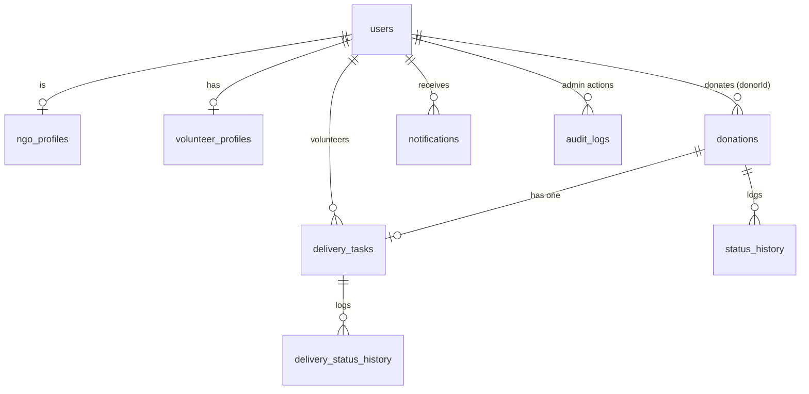

# 🍲 SoulFeeder — Feed Every Soul

A full-stack platform that moves surplus food from **donors** to **verified NGOs**, delivered by **volunteers**, overseen by **admins**.
Stack: React (Vite) · Spring Boot 3.3 (Java 17) · Spring Security + JWT · JPA/Hibernate · H2 (dev) / MySQL (prod) · Docker.

## Features
| Area | What it does |
|---|---|
| 🔐 Auth | Register/login, BCrypt hashing, JWT, role-based access (DONOR, NGO, VOLUNTEER, ADMIN). Roles are enforced on the server and loaded from the DB on every request. |
| 🍱 Donations | Post with prep/expiry times and safety notes, optional photo, edit-safe cancellation, search / filter / sort / pagination. |
| 🤝 Claiming | Only admin-verified NGOs. A database row lock guarantees one winner when two NGOs claim at once. |
| 🛵 Delivery | Claim opens a task; volunteers accept (max 3 active), pick up, deliver. Expired food cannot be accepted or collected. Full history per task. |
| 📍 Tracking | Live journey (Posted → Claimed → On the way → Delivered) with history and delivery details. |
| 🔔 Notifications | In-app inbox with unread count (polling, 30 s). |
| 🛡️ Admin | NGO verification queue, user search + suspend/reinstate, real impact statistics, audit log. |
| 👤 Profile | Change name and password. |

## Architecture
```
 React SPA (Vite) ──HTTPS/JSON + Bearer JWT──▶ Spring Boot REST API ──JPA──▶ MySQL (H2 in dev)
   axios client                                 JwtFilter → SecurityConfig (role rules)
   role-aware UI                                Controller → Service (@Transactional, rules) → Repository
                                                Errors (@RestControllerAdvice) · Swagger UI · uploads/ (photos)
```

Backend packages live flat in `com.soulfeeder` (controller / service / repository / model classes grouped by file) to keep the project small. Splitting into `controller`, `service`, `repository`, `entity`, `dto` packages is a mechanical refactor and a good next step.

## Run locally (Windows PowerShell) — JDK 17+, Maven, Node 18+
```powershell
# Backend (H2 database, zero setup)
cd backend
$env:ADMIN_EMAIL="admin@soulfeeder.local"; $env:ADMIN_PASSWORD="choose-a-strong-one"
mvn spring-boot:run          # http://localhost:8080  ·  Swagger: /swagger-ui.html

# Frontend (second terminal)
cd frontend; npm install; npm run dev     # http://localhost:5173
```
MySQL instead of H2: `CREATE DATABASE soulfeeder;` then `$env:DB_PASSWORD="..."; mvn spring-boot:run "-Dspring-boot.run.profiles=mysql"`.

## Tests
```powershell
cd backend;  mvn test      # JUnit 5 + Mockito unit tests, MockMvc security tests, claim-concurrency test
cd frontend; npm test      # Vitest + React Testing Library
```
Covered business rules: expired/invalid donations rejected, unverified NGO cannot claim, double-claim blocked (including a two-thread race), ownership and role checks on every status change, invalid state jumps rejected, volunteer limits, expired food cannot be collected, admin overrides audited, no password hash in responses, 401/403 behaviour.

## Deploy (Docker)
```powershell
copy .env.example .env     # edit every value
docker compose up --build  # UI http://localhost:8081 · API http://localhost:8080
```
Set `JWT_SECRET` (32+ chars), strong DB/admin passwords, `CORS_ORIGIN` = your real UI origin, `PUBLIC_API_URL` = your real API URL, and put both behind HTTPS (e.g. a reverse proxy or your host's TLS).

## API summary
`POST /api/auth/register|login` · `GET|PUT /api/users/me` · `POST /api/users/me/password`
`POST /api/donations` · `GET /api/donations` · `GET /api/donations/search` · `GET /api/donations/{id}` · `POST /api/donations/{id}/claim` · `PATCH /api/donations/{id}/status` · `GET /api/donations/{id}/history|delivery` · `POST /api/donations/{id}/image` · `GET /api/images/{name}`
`GET|PUT /api/ngo/verification` · `GET /api/admin/ngos` · `PATCH /api/admin/ngos/{id}/verification`
`GET|PUT /api/volunteer/profile` · `GET /api/volunteer/tasks?scope=open|mine` · `POST /api/volunteer/tasks/{id}/accept` · `PATCH /api/deliveries/{id}/status` · `GET /api/deliveries/{id}/history`
`GET /api/notifications` · `POST /api/notifications/read-all`
`GET /api/admin/dashboard|users|audit` · `PATCH /api/admin/users/{id}/suspension` · `GET /api/stats` (public)
Full, interactive docs with a Bearer-token button: **/swagger-ui.html** (disable in production with `SWAGGER_ENABLED=false`).
Errors always look like `{"status":409,"message":"..."}`; validation errors add `"fields":{...}`.

## Security checklist
- [x] BCrypt password hashing; hash never serialized to clients
- [x] Roles loaded from DB per request, never trusted from the client; ADMIN cannot be self-registered
- [x] Endpoint rules + ownership checks in the service layer; suspended users blocked immediately
- [x] Row locks prevent double claim / double accept; state machine validated server-side
- [x] Bean Validation + generic login errors; image uploads sniffed by file signature, size-capped, randomly renamed, path-traversal-safe
- [x] Secrets via environment variables; `.env` git-ignored; Docker runs as non-root
- [ ] Rate limiting / login lockout · [ ] token revocation on password change · [ ] httpOnly-cookie auth · [ ] forgot-password email flow · [ ] DB migrations (Flyway) · [ ] virus scanning / cloud storage for uploads

## Known limitations
Notifications poll instead of push · Tracking sidebar loads all donations (only Browse is paged) · single-instance disk uploads · `ddl-auto=update` instead of migrations · no forgot-password (needs email delivery) · backend code is in a flat package · no map/geolocation filtering.

## Suggested Git history
`chore: scaffold spring boot + vite` · `feat: donation API` · `feat: claim with row locking` · `feat: JWT auth and roles` · `feat: NGO verification + admin` · `feat: volunteer delivery + notifications` · `feat: admin dashboard, paging, photos` · `test: service, security, concurrency` · `chore: docker + CI + docs`

## Interview talking points
1. **Concurrency:** `SELECT … FOR UPDATE` (`PESSIMISTIC_WRITE`) on claim/accept; always lock donation before task to avoid deadlocks; proven by `ClaimConcurrencyTest`.
2. **Security model:** stateless JWT, but the user (and role) is re-read from the DB each request, so suspension/role changes apply immediately. Trade-off: no instant token revocation on password change.
3. **Food safety as a business rule:** expiry validated at create, claim, accept and pickup.
4. **State machines:** donation and delivery transitions are whitelisted maps; unit-tested.
5. **Honest trade-offs:** sessionStorage token (XSS exposure) vs httpOnly cookies (CSRF handling); polling vs WebSockets; `update` vs migrations.
6. **Next steps:** Flyway, rate limiting, WebSocket/SSE notifications, geo-search, cloud image storage, package refactor.

## Verification status (be upfront in interviews)
Frontend: 5 tests pass and the production build succeeds. Backend: written but **not compiled or run by the author of this scaffold** — run `mvn test` first and fix anything it reports. Docker files and the CI workflow are also untested.
